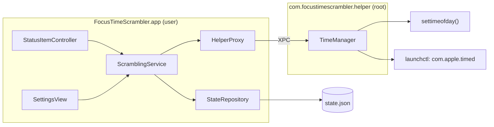
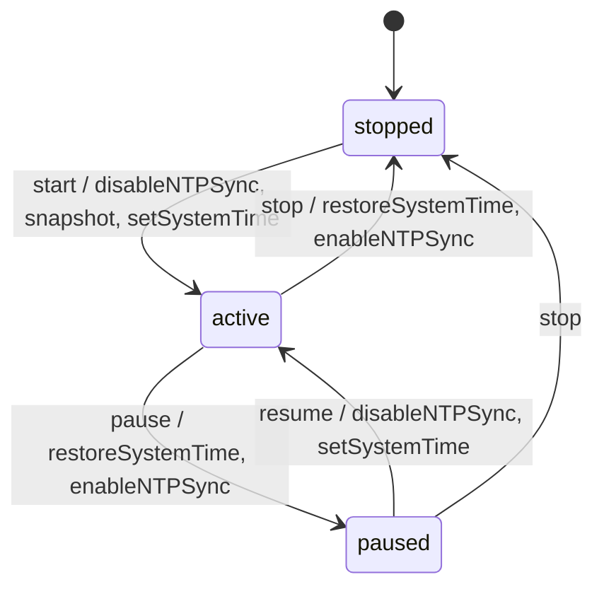
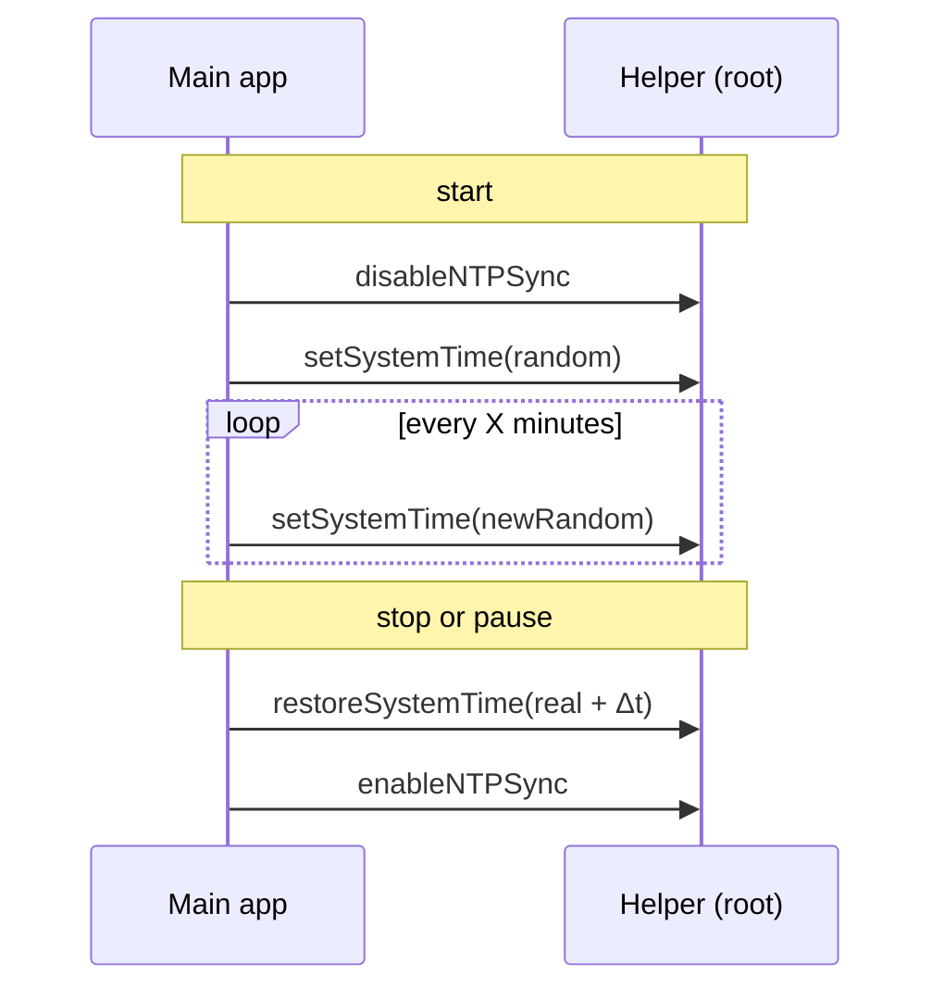

# Plan: focus-time-scrambler / time-scramble

Migrated from spec-kit `plan.md`, `data-model.md`, `contracts/xpc-protocol.md`, `tasks.md` and `quickstart.md` (all 2026-06-21). Task IDs T001–T020 are kept. Role: standalone; the XPC protocol is internal to this project, so it lives here, not in `contracts/`.

## Short

- Two processes: an AppKit menu-bar app and a root helper installed via `SMJobBless`, talking over XPC.
- State is one JSON file, written only on state transitions, never on interval ticks.
- 20 tasks, about 78–142 h by the source estimates; none started.
- The Xcode project is still the SwiftUI template and contradicts this plan; reconfigure it first (see "Files to change").
- Open questions 1–2 in `feature.md` (time vs timezone, pause behaviour) can change this plan; settle them before T009.

## Stack

| Layer | Choice |
|---|---|
| Language | Swift 5.9+ (Xcode 15+), Swift 5 language mode |
| UI | AppKit: `NSStatusItem` + `NSMenu`, settings in an `NSViewController` |
| Privilege | `ServiceManagement` (`SMJobBless`) + `NSXPCConnection`; helper calls `settimeofday()` and `launchctl` |
| Storage | `Foundation` `JSONEncoder` / `JSONDecoder`, atomic temp-file + rename |
| Tests | XCTest; no XCUITest for the menu (R-006) |

## Architecture



## Files to change

| Path | Change |
|---|---|
| `time-scramble.xcodeproj/project.pbxproj` | `ENABLE_APP_SANDBOX = NO`; `MACOSX_DEPLOYMENT_TARGET = 13.0` (now 26.5); add helper and test targets; embed helper at `Contents/Library/LaunchServices/` |
| main app `Info.plist` | `SMPrivilegedExecutables` → helper id + code-signing requirement |
| `PRODUCT_BUNDLE_IDENTIFIER` | now `scramble.time-scramble`; helper's `SMAuthorizedClients` must reference the final app id |
| `time-scramble/time_scrambleApp.swift`, `ContentView.swift` | replace the SwiftUI template with the AppKit entry point and status item |

Source folder: the plan names it `FocusTimeScrambler/`, the repo has `time-scramble/`. Rename the folder and scheme, or keep `time-scramble/` and map the paths below; decide in T001.

## Files to create

### Main app: UI

| Path | Purpose |
|---|---|
| `FocusTimeScrambler/App/FocusTimeScramblerApp.swift` | `@main` entry point |
| `FocusTimeScrambler/App/AppDelegate.swift` | `NSApplicationDelegate`, status item bootstrap, crash-recovery prompt |
| `FocusTimeScrambler/App/SMJobBlessHelperInstaller.swift` | helper install flow (or inside `AppDelegate`) |
| `FocusTimeScrambler/MenuBar/StatusItemController.swift` | `NSStatusItem` + `NSMenu`, state-driven icon |
| `FocusTimeScrambler/Views/SettingsView.swift` | interval input panel |

### Main app: logic

| Path | Purpose |
|---|---|
| `FocusTimeScrambler/Services/ScramblingService.swift` | session state machine, interval timer, random time, XPC call order |
| `FocusTimeScrambler/Services/HelperProxy.swift` | XPC connection to the helper, async/await wrappers, error mapping |
| `FocusTimeScrambler/Storage/StateRepository.swift` | atomic JSON read/write, corruption handling |
| `FocusTimeScrambler/Models/{AppState,SessionState,RealTimeSnapshot}.swift` | `Codable` models with validation |
| `FocusTimeScrambler/Helpers/HelperXPCProtocol.swift` | shared protocol, same file as in the helper |

### Helper and tests

| Path | Purpose |
|---|---|
| `PrivilegedHelper/main.swift` | `NSXPCListener`, client code-signing validation |
| `PrivilegedHelper/HelperXPCProtocol.swift` | shared `@objc` protocol |
| `PrivilegedHelper/TimeManager.swift` | `settimeofday()` and `launchctl` wrappers, error codes |
| `PrivilegedHelper/Info.plist` + launchd plist | `SMAuthorizedClients`, Mach service name |
| `FocusTimeScramblerTests/{ScramblingService,StateRepository,AppState}Tests.swift` | unit tests; plus HelperProxy contract tests (T018) |

## Data model

`state.json` holds one `AppState` document (< 1 KB). It is written on start, pause, resume and stop only. `schemaVersion` is reserved and absent in v1.

| Entity.field | Type | Rule |
|---|---|---|
| `AppState.intervalMinutes` | `Int` | 1 ≤ value ≤ 120 |
| `AppState.sessionState` | `SessionState` (`String` raw) | `stopped` / `active` / `paused` |
| `AppState.realTimeSnapshot` | `RealTimeSnapshot?` | non-null in `active` and `paused`; null after `stopped` |
| `RealTimeSnapshot.capturedAt` | `String` | ISO 8601, for manual inspection |
| `RealTimeSnapshot.unixTimestamp` | `Double` | > 0 and finite |



### Invariants (enforced by `ScramblingService`)

- The snapshot is captured **before** the first `setSystemTime` call, never after.
- Real time is restored **before** `stopped` or `paused` is written to disk.
- `disableNTPSync` once on `stopped → active`; `enableNTPSync` once on every transition to `stopped` or `paused`.
- Restore time = `unixTimestamp` + elapsed seconds measured with `mach_absolute_time` since session start; never the raw snapshot.

### Validation

| Check | On failure |
|---|---|
| `intervalMinutes` outside [1, 120] | human-readable message, scrambling does not start |
| unknown `sessionState` | file treated as corrupt → prompt fresh start |
| `unixTimestamp` ≤ 0, NaN or ±Inf | snapshot corrupt → prompt fresh start, no restore with bad data |
| missing field / type mismatch (`DecodingError`) | log, treat as corrupt → prompt fresh start |

Example (`active`; `stopped` has `"realTimeSnapshot": null`):

```json
{
  "intervalMinutes": 30,
  "sessionState": "active",
  "realTimeSnapshot": { "capturedAt": "2026-06-21T09:00:00Z", "unixTimestamp": 1750500000.0 }
}
```

## Internal interface: XPC helper protocol

The helper `com.focustimescrambler.helper` runs as root under launchd. The main app never calls `settimeofday()` or `launchctl` itself. The protocol file is compiled into both targets; do not put it in a framework.

```swift
@objc protocol HelperXPCProtocol {
    func setSystemTime(to timestamp: Double, withReply reply: @escaping (Error?) -> Void)
    /// timestamp = snapshot + elapsed Δt, computed by the caller
    func restoreSystemTime(to timestamp: Double, withReply reply: @escaping (Error?) -> Void)
    func disableNTPSync(withReply reply: @escaping (Error?) -> Void)   // idempotent
    func enableNTPSync(withReply reply: @escaping (Error?) -> Void)    // idempotent
}
```

| Operation | Called | Helper does |
|---|---|---|
| `setSystemTime` | each tick; after `disableNTPSync` succeeded | `settimeofday()` to a random time in 00:00:00–23:59:59 of the current day |
| `restoreSystemTime` | stop, pause; needs a valid snapshot | `settimeofday()` with the caller's corrected timestamp |
| `disableNTPSync` | `stopped → active`, resume | `launchctl bootout system/com.apple.timed` |
| `enableNTPSync` | after restore on stop / pause | `launchctl bootstrap system /System/Library/LaunchDaemons/com.apple.timed.plist` |



### Errors (`NSError`, domain `com.focustimescrambler.helper`)

| Code | Name | Trigger | UI |
|---|---|---|---|
| 1001 | `syscallFailed` | `settimeofday()` non-zero | human-readable message |
| 1002 | `launchctlFailed` | `launchctl` non-zero exit | human-readable message |
| 1003 | `invalidTimestamp` | timestamp ≤ 0, NaN or infinite | human-readable message |
| 1004 | `connectionInterrupted` | XPC invalidated before reply | "Connection to system helper lost — please restart the app" |

### Security

- Install: `SMJobBless` with the user Authorization dialog, once per machine.
- Caller check: helper validates the client's code-signing requirement (`SMAuthorizedClients`) before any call; the app declares the helper in `SMPrivilegedExecutables`.
- Mach service `com.focustimescrambler.helper` is not advertised.
- Surface: 4 methods; no file I/O, no network, no shell beyond the two `launchctl` commands.
- Both targets use Hardened Runtime without `allow-unsigned-executable-memory`.

## Step ordering

Critical path:


MVP = T001–T010, T014–T016, T017. T013 (pause) and T020 (release on a VM) follow. Parallel: T003/T004 with T001; UI (T011/T012) with T017 once the proxy exists; T017 with T018.

### Discovery and design

| ID | Task | Est. | Deps | Done when |
|---|---|---|---|---|
| T001 | Code signing and `SMJobBless` entitlements | 1–2 h | — | identity, entitlement changes and CI step (or "manual step") documented |
| T002 | Permission UX and failure messages | 1 h | T001 | messages and recovery steps for codes 1001–1004 decided |
| T003 | `HelperXPCProtocol.swift` in both targets | 1–2 h | T001 | matches the protocol above, compiles |
| T004 | `AppState`, `SessionState`, `RealTimeSnapshot` | 2–3 h | — | encode/decode the JSON examples; validation rules enforceable |

### Foundation

| ID | Task | Est. | Deps | Done when |
|---|---|---|---|---|
| T005 | `StateRepository` | 4–8 h | T004 | atomic write (temp → move); corrupt file → "prompt fresh start" in tests |
| T006 | Helper `TimeManager` | 6–10 h | T003 | `settimeofday` + `launchctl` wrappers return contract error codes |
| T007 | Helper XPC entry (`main.swift`) | 4–6 h | T003, T006 | accepts connections from a signed client only |
| T008 | `HelperProxy` | 3–5 h | T003, T007 | 4 async methods, error mapping, reconnect on invalidation |

### User stories

| ID | Task | Est. | Deps | Done when |
|---|---|---|---|---|
| T009 | US-1 `ScramblingService` | 12–20 h | T005, T008 | start = disableNTP → snapshot → set random now and every X min; invariants hold |
| T010 | US-1 restore on stop + crash recovery | 4–8 h | T009, T006, T005 | stop = restore(Δt) → enableNTP; then `stopped`, snapshot null |
| T011 | US-2 `SettingsView` + interval persistence | 4–8 h | T005, T004 | 1–120 accepted and persisted; invalid input rejected; pre-filled on launch |
| T012 | US-3/US-4 `StatusItemController` | 4–6 h | T009, T011 | Start / Pause / Stop / Open Settings; icon shows Active / Paused / Stopped |
| T013 | US-5 pause / resume (P3) | 3–5 h | T009, T011, T012 | pause restores and writes `paused`; resume re-scrambles |

### Integration, QA, release

| ID | Task | Est. | Deps | Done when |
|---|---|---|---|---|
| T014 | `SMJobBless` install + entitlements | 8–16 h | T001, T003, T007, T008 | helper installs to `/Library/PrivilegedHelperTools/`, runs as root |
| T015 | Embed helper + build step | 3–6 h | T014 | `xcodebuild` output contains the helper at `Contents/Library/LaunchServices/` |
| T016 | Manual validation run (scenarios below) | 2–4 h | T009, T011, T012, T014, T015 | all checkpoints pass |
| T017 / T018 | Unit tests / helper contract tests with a test double | 6–12 h / 3–6 h | T004, T005, T009, T010 / T003, T008 | coverage targets met / error codes and call order verified without root |
| T019 / T020 | Docs + release notes / signed build on a clean macOS 13 VM | 1–2 h / 6–12 h | T016, T017 / T014, T015, T019, T017 | quickstart updated / smoke tests pass on the VM |

## Test plan

### Automated

```bash
xcodebuild test -scheme FocusTimeScrambler -destination 'platform=macOS' -enableCodeCoverage YES
```

- Pass: all tests green, line coverage ≥ 80%, `ScramblingService` and `StateRepository` ≥ 95%.
- Unit: state transitions and invariants, timer, random-time bounds, Δt restore math, JSON round-trip, corrupt-file paths, interval validation.
- Contract (T018): `HelperProxy` against a test double for all 4 methods and codes 1001–1004.
- Rerun after any change to `ScramblingService`, `StateRepository`, `AppState` or `TimeManager`.

### Manual validation (needs admin; "Set time automatically" ON before testing)

Build: `xcodebuild -scheme FocusTimeScrambler -configuration Release -derivedDataPath build/`. First launch shows the authorization dialog; afterwards the icon is in the menu bar, the helper is in `/Library/PrivilegedHelperTools/`, and `state.json` is `{ "intervalMinutes": 30, "sessionState": "stopped", "realTimeSnapshot": null }`.

| # | Scenario | Expected |
|---|---|---|
| 1 | Interval 2, Start | random time within 15 s; ~5 changes in 10 min; setup < 30 s (SC-001, SC-002) |
| 2 | Stop | real time ±5 s; `stopped`, snapshot null; auto time re-enabled (SC-003, SC-006) |
| 3 | Close settings while active; open menu | keeps scrambling; menu has Pause, Stop, Open Settings; icon shows state |
| 4 | Pause 5 min, then Resume | no changes while paused; `paused` → `active`; change within 2 min 15 s |
| 5 | `kill -9 $(pgrep -x FocusTimeScrambler)`, relaunch | "A previous session was interrupted. Restore real time now?" → real time ±5 s (SC-005) |

Also: interval inputs `0`, `-5`, `abc`, `200` each show a readable error and do not start (FR-010). With the helper removed in System Settings → Login Items & Extensions, Start shows "Unable to contact system helper…" and changes nothing (FR-007).

### Performance (2-minute interval, after scenario 1)

| Metric | Target | How |
|---|---|---|
| Clock change latency | ≤ 500 ms after tick | `date` before and after each change |
| App / helper memory | < 10 MB / < 5 MB | Activity Monitor |
| Idle CPU | < 0.5% | Activity Monitor, 5-min average |
| Missed intervals in 60 min | 0 (~30 changes) | count changes |

## Inconsistencies found during migration

- **Pause**: US-5 and quickstart part A expect the last scrambled value while paused; the data model, T013 and the XPC sequence restore real time. See `feature.md` open question 2.
- **Day bounds**: FR-011 says the calendar day 00:00–23:59; the XPC contract says the UTC day. For a user far from UTC these differ; local day is the likely intent.
- **Xcode project vs plan**: sandbox on, deployment target 26.5, one target, SwiftUI template, folder `time-scramble/`; see "Files to change".
- **`SMJobBless`** is deprecated since the macOS 13 SDK; accepted in R-001, recheck on the current SDK in T001.
